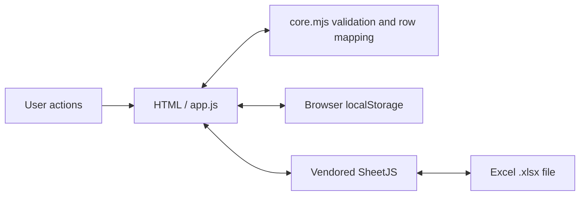

# Architecture and Assignment Design

Project: Address Book — Extreme Programming assignment  
Student: Liu Peikun (刘培坤), 832401213  
Work mode: Individual project

## 1. Goals

The application is a browser-based address book. It supports adding, viewing, editing and deleting contacts; marking favorite contacts; storing multiple contact methods; searching; and importing/exporting Excel workbooks.

The assignment's required feature groups are favorites, multiple contact methods, Excel import/export and page styling. Cloud deployment is an optional extension. Publishing source code or running the application locally does not by itself establish that the cloud-deployment requirement has been met.

## 2. Module boundaries

| Module | Responsibility |
| --- | --- |
| `dist/index.html` | Page structure, labeled form controls, dialogs and application entry point |
| `dist/styles.css` | Visual styling, responsive layout and focus/interaction states |
| `dist/scripts/app.js` | UI events, application state, DOM rendering, local persistence and workbook file operations |
| `dist/scripts/core.mjs` | Pure contact validation and transformations between contacts and worksheet rows |
| `dist/vendor/xlsx.full.min.js` | Vendored SheetJS workbook parser/writer |
| `tests/core.test.mjs` | Domain and transformation checks using the Node.js test runner |

The domain module is independent of the browser. Keeping conversion and validation outside the UI makes spreadsheet behavior easier to test and keeps file-format decisions separate from screen layout.

## 3. State and persistence

The contact schema is `{ id, name, company, note, favorite, phones, emails, socials, addresses, createdAt, updatedAt }`. Phone, email, social and address values are arrays of strings. The editor and import path both pass data through domain validation. The browser storage key is `linbook.contacts.v1`.

The browser owns the working address book. The application persists it in `localStorage` and restores it on later visits in the same browser origin. Search and favorites filters operate on that contact collection; they do not create a separate source of truth.

This design keeps the assignment runnable without a backend or paid service. Its practical limits are explicit:

- Data belongs to the current browser and origin; another device or browser does not receive it automatically.
- Clearing browser storage can remove saved data. An exported workbook provides a portable backup.
- This is a single-user application with no account login, server authorization or concurrent editing.
- It should not be used as a production repository for sensitive personal information without an appropriate storage and access design.

## 4. Contact and UI operations

Create and edit operations collect form values, normalize them, validate the resulting contact, update the contact collection and persist the change. The screen then rerenders from the updated state.

Favorites are a property of the contact itself. The favorites view filters that property, so edits and spreadsheet transfers retain the same favorite status.

Repeatable input rows allow one contact to hold more than one phone number, email, social account or address. Array storage avoids imposing a fixed number of methods or losing values that contain punctuation.

Search works against the stored collection and shows an empty state when nothing matches. Destructive contact removal should be deliberate and confirmed in the application.

## 5. Excel contract

An exported workbook represents each contact in one row. Each information category has a separate column. Repeated contact methods are encoded as JSON array strings inside their category cells. This supports values containing commas, quotation marks or line breaks without relying on ambiguous delimiters.

Phone numbers are text, not numbers. The application must preserve values such as `+86...` or leading-zero strings instead of asking Excel to infer their numeric type. User-provided strings are written as string cells rather than formulas.

The exact worksheet headers are `姓名`, `公司/组织`, `电话（JSON数组）`, `邮箱（JSON数组）`, `社交账号（JSON数组）`, `地址（JSON数组）`, `收藏` and `备注`. Header order may change, but all eight names must appear exactly once. The favorite column accepts `1` or `0`; empty method arrays use `[]`. Only the first worksheet is imported, and the interface reports that choice. Worksheets containing formulas are rejected.

The template and export use the same schema as the importer. Import proceeds in this order:

1. Check the selected file and the size limit.
2. Parse the workbook with the vendored library.
3. Check required column headers.
4. Convert and validate every non-empty contact row.
5. If a row is invalid, report the problem without changing the address book.
6. If all rows are valid, add the imported contacts and persist the resulting collection.

An import skips exact duplicates based on all public contact fields, ignoring method-array order. Matching names with different information become separate contacts; imports never silently overwrite existing data. Each selected file may be at most 5 MB, each import at most 1,000 rows, and the complete address book at most 10,000 contacts. Each method category permits 30 values of up to 500 characters. Name, company and note limits are 100, 150 and 1,000 characters respectively.

## 6. Rendering and failure handling

User-entered and imported text is untrusted. It must be assigned through safe DOM text and value properties, not inserted into executable markup. This applies to cards, tables, search results, detail views and error messages.

Validation errors stay understandable to the user: missing names, invalid repeated fields, unsupported headers and unreadable workbook files should produce clear feedback. A failed import must not partially update saved data. Storage failures should be reported rather than falsely announcing that data was saved.

## 7. Verification and evidence

Pure-function tests cover the rules that can otherwise cause silent data loss: normalization, required values, repeated methods and worksheet row conversion. A workbook round trip checks that exporting and reimporting contacts preserves the supported information.

Browser verification covers the interaction sequence: create a contact, add multiple methods, mark it as a favorite, edit it, search for it, refresh to check persistence, export a workbook and import a correctly formatted workbook. Invalid-file feedback and a narrow viewport should also be checked.

Screenshots, the running video, test results, commit counts, release URL and pull-request URL are evidence only when collected from the actual completed project. This document describes the architecture; it does not substitute for that evidence.

## 8. Repository workflow and assignment reporting

No initial repository was specified for this individual assignment. The project therefore starts in an original GitHub repository; it should not be described as a fork of a nonexistent starter.

Meaningful commits record actual stages of development. A feature branch and pull request make the work reviewable, and a release identifies a runnable version. The final blog should link directly to the repository, code standards, commit history, release and pull request.

The author is the sole student participant. No teammate, independent review or collaboration difficulty is invented. The PSP table distinguishes estimated and measured time, and any unmeasured or retrospective values are labeled honestly.
