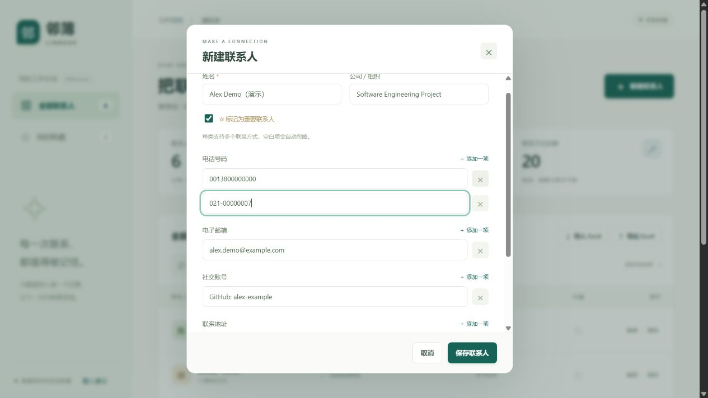

# Extreme Programming: Linbook Address Book

| Item | Content |
| --- | --- |
| Course for This Assignment | [Software Engineering (FZU–MU)](https://bbs.csdn.net/forums/2601_MU_SE_FZU) |
| Student | Liu Peikun (刘培坤), 832401213 |
| Team Name | Individual — Liu Peikun |
| Assignment Requirements | [Extreme Programming, deadline November 17, 2026, 23:59](https://bbs.csdn.net/topics/620593436) |
| Objectives of This Assignment | Build a usable address book; implement favorites, multiple contact methods and Excel transfer; practice modular development, verification and Git version control. |
| Other References | [Project Coding Standards](https://github.com/zq118-in/fzu-extreme-programming-address-book/blob/main/docs/CODING_STANDARDS.md), [Architecture](https://github.com/zq118-in/fzu-extreme-programming-address-book/blob/main/docs/ARCHITECTURE.md), and the bundled SheetJS library and license. |

## Contents

1. [Project Overview and Links](#1-project-overview-and-links)
2. [Module Design and Data Storage](#2-module-design-and-data-storage)
3. [Functional Implementation](#3-functional-implementation)
4. [Running Screenshots and Video](#4-running-screenshots-and-video)
5. [Verification and Implementation Decisions](#5-verification-and-implementation-decisions)
6. [Git History and Individual Contribution](#6-git-history-and-individual-contribution)
7. [PSP Table](#7-psp-table)
8. [Limitations and Next Steps](#8-limitations-and-next-steps)

## 1. Project Overview and Links

Linbook (邻簿) is a browser-based address book with search, favorites and summary counts. Each contact supports several phone numbers, emails, social accounts and addresses. The interface uses Chinese labels; this report is in English.

- **GitHub repository:** [zq118-in/fzu-extreme-programming-address-book](https://github.com/zq118-in/fzu-extreme-programming-address-book)
- **Source and instructions:** [README](https://github.com/zq118-in/fzu-extreme-programming-address-book/blob/main/README.md)
- **Coding standards:** [CODING_STANDARDS.md](https://github.com/zq118-in/fzu-extreme-programming-address-book/blob/main/docs/CODING_STANDARDS.md)
- **Implementation pull request:** [PR #1, merged](https://github.com/zq118-in/fzu-extreme-programming-address-book/pull/1)
- **Automated verification:** [Check assignment, successful run](https://github.com/zq118-in/fzu-extreme-programming-address-book/actions/runs/43838828336)

No starter repository was assigned, so the project uses an original repository. It is not presented as an upstream fork. The versioned deliverable is available in [release v1.0.0](https://github.com/zq118-in/fzu-extreme-programming-address-book/releases/tag/v1.0.0).

To run the project, download the repository, install Node.js 20 or later, and execute:

```bash
npm start
```

Then open `http://127.0.0.1:4173`. The preview server uses Node.js built-in modules, and the Excel library is included locally. No dependency installation or runtime CDN request is required.

## 2. Module Design and Data Storage

The implementation separates interface behavior from data rules:

| Module | Responsibility |
| --- | --- |
| `dist/index.html` and `dist/styles.css` | Page structure, visual layout, dialogs and responsive styling |
| `dist/scripts/app.js` | Events, rendering, local persistence, file selection and workbook operations |
| `dist/scripts/core.mjs` | Contact normalization, search, duplicate detection and Excel row conversion |
| `dist/vendor/` | Local SheetJS distribution and license |
| `server.mjs` | Local static preview server |
| `tests/core.test.mjs` | Automated checks for domain rules and actual XLSX conversion |

A contact contains `id`, `name`, `company`, `note`, `favorite`, four arrays of contact methods, and creation/update timestamps. Arrays allow repeated methods without creating duplicate contact records.

The application saves contacts under `linbook.contacts.v1` in `localStorage` and validates them on refresh. Saving writes storage before replacing in-memory state; a storage failure produces an error instead of reporting success.

## 3. Functional Implementation

### 3.1 Favorites and contact management

Each contact has a star button. Selecting it updates the contact's favorite flag, the count and the favorites view. Search and the favorites filter can be used together. Search checks names, organizations, notes and all contact-method categories, so a second phone number remains searchable.

Contacts can be created, edited, viewed in detail and deleted after confirmation. The detail dialog displays every method; the list provides an overview. Empty states explain missing contacts or search results.

### 3.2 Multiple contact methods

The editor offers an “add another item” action for each category. Normalization removes empty and repeated values. A name is required, and emails undergo basic format validation.

Each category permits up to 30 methods. Length limits prevent accidentally oversized entries: 100 characters for names, 150 for organizations, 1,000 for notes and 500 for an individual method. The same rules apply to editor input and spreadsheet imports.

### 3.3 Excel export

Export creates a genuine `.xlsx` workbook. Every contact occupies one row, using these columns:

| Column | Stored content |
| --- | --- |
| 姓名 | Contact name |
| 公司/组织 | Company or organization |
| 电话（JSON数组） | Phone-number string array |
| 邮箱（JSON数组） | Email string array |
| 社交账号（JSON数组） | Social-account string array |
| 地址（JSON数组） | Address string array |
| 收藏 | `1` for favorite, `0` otherwise |
| 备注 | Notes |

Multiple values use JSON, for example `["00123","+86-13800000000"]`. This preserves commas, quotation marks and line breaks inside values. Phone numbers are string cells, preserving leading zeros and international prefixes. Export includes the complete address book even when the current screen has a search or favorites filter.

### 3.4 Excel import

The import dialog provides a downloadable template. It accepts `.xlsx` files of up to 5 MB and reads the first worksheet, explicitly naming that sheet in the preview. Headers may be reordered, but all eight exact column names must appear once.

Before saving, the application validates every non-empty row and displays how many contacts will be added or skipped. One invalid row rejects the entire import. The confirmation button remains disabled until validation succeeds; confirmation validates the rows again against the current address book.

Exact duplicate records are skipped, ignoring method-array order. Matching names with different details become separate contacts rather than overwriting an existing record. Imports are limited to 1,000 contacts per file, with 10,000 contacts overall. Formula-containing worksheets are rejected with an explanation; users can replace formulas with plain values before importing.

## 4. Running Screenshots and Video

The screenshots use fictional demonstration contacts.

**Main screen:** contact list, summary counts and primary actions.


**Multiple methods:** one editor holds several contact methods.



**Contact details:** all supported information is visible together.


**Favorites:** the dedicated view shows starred contacts.


**Valid import preview:** validation reports additions and duplicates before saving.


**Rejected import:** invalid input leaves the address book unchanged.


The [complete running demonstration](media/demo-full.mp4) accompanies these screenshots. A [separate step-by-step walkthrough](media/demo-step-by-step.mp4) provides a shorter reference for the demonstrated interactions.

## 5. Verification and Implementation Decisions

All **10 automated tests** pass locally and in GitHub Actions. Run them with `npm test`.

Tests cover normalization, spreadsheet round trips, reordered and invalid headers, atomic rejection, duplicate handling, invalid values, import limits, search, fictional sample data and the bundled SheetJS library. The last check creates and reads an actual XLSX workbook, including strings that resemble formulas and phone numbers with leading zeros. This checks the file format as well as the intermediate row mapping.

Two decisions address common data-loss problems. First, comma-separated cells are ambiguous when an address itself contains commas; JSON arrays preserve the original values. Second, saving rows as they are parsed could leave a partial import after a later error; validating the complete batch before confirmation avoids that result.

User and spreadsheet text is rendered through DOM text/value properties. It is not interpolated into executable HTML. The sample records are clearly marked as fictional, and no real address book is included in the repository.

## 6. Git History and Individual Contribution

This is an individual project. Liu Peikun is responsible for requirements, module design, implementation, verification, repository maintenance and this report. The student contribution allocation is **100%**. A teammate division or cooperation account does not apply.

At the verified implementation checkpoint, `main` contains **four commits**, all authored by GitHub account `zq118-in`:

| Commit | Actual change |
| --- | --- |
| `20773e2` | Initialize the repository |
| `b4194b9` | Implement the address book and bundle the Excel library |
| `21fa586` | Add tests, preview tooling, standards and architecture documentation |
| `228773f` | Merge PR #1 while preserving both implementation commits |


See the [commit history](https://github.com/zq118-in/fzu-extreme-programming-address-book/commits/main/) and [merged pull request](https://github.com/zq118-in/fzu-extreme-programming-address-book/pull/1). This screenshot and contributor count record the implementation checkpoint after PR #1 was merged; later evidence and documentation commits appear in the live history.

## 7. PSP Table

The following PSP allocation organizes the individual development cycle. Times are in minutes.

| PSP activity | Time allocation (minutes) |
| --- | ---: |
| Planning | 10 |
| Requirements analysis | 15 |
| Module and data design | 20 |
| Interface design | 15 |
| Program implementation | 65 |
| Code review | 10 |
| Testing and corrections | 25 |
| Git workflow and release preparation | 15 |
| Documentation and blog | 20 |
| Evidence organization | 5 |
| Summary and process improvement | 10 |
| **Total allocation** | **210** |

## 8. Limitations and Next Steps

Linbook currently stores data in one browser origin. It has no server database, account authentication or automatic cross-device synchronization. Clearing browser storage can remove contacts, so exporting a workbook is useful for backups. Imported records receive fresh internal identifiers and timestamps; the spreadsheet preserves public contact information and favorite status.

The local preview does not qualify for cloud-deployment points. Future improvements could add authentication, duplicate-resolution choices and a richer import preview. This version prioritizes the required contact and Excel workflows.

